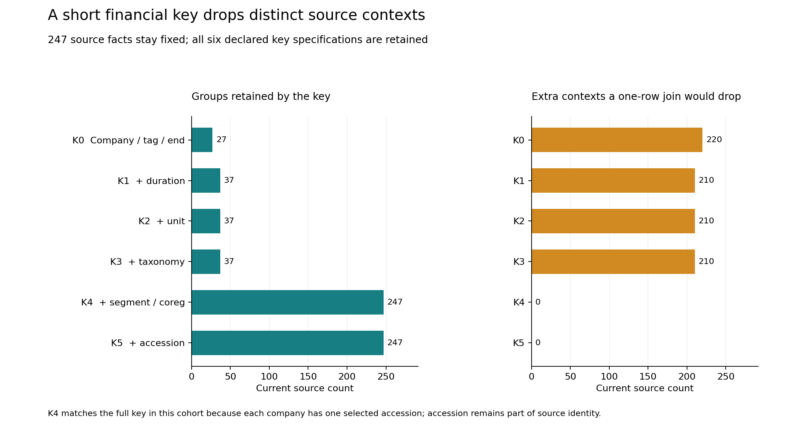

# Financial facts need their full context

A company, financial tag and period-end date do not uniquely identify a financial fact. A short join key can overwrite different durations or segments while making the resulting table look tidy.

**Finding:** the company/tag/end-date key collapses 247 source facts into 27 groups. A one-row-per-key join would discard 220 distinct contexts. Adding duration still leaves 210 extra contexts in 37 groups; retaining segment/coregistrant identity separates every observed fact in this cohort.

## Practical use

Carry accession, tag, taxonomy version, period, duration, unit, segment and coregistrant identity through a financial-data join. Require the complete source context before returning a qualified fact, and abstain when it is absent or ambiguous. Classify context differences before interpreting a changed value as a revision.

An authored naive-winner simulation finds 215 facts with numeric values different from their short-key winner. That count describes incompatible contexts as well as values; it is not a verified restatement count, financial loss or historical feature-leakage estimate. Each company has one selected filing, so the sample contains no repeated contexts across accessions.

The runnable [implementation exercise](EXERCISE.md) preserves an instructive mistake: an Apple example guessed a 2026 taxonomy, while its 2026 filing uses us-gaap/2025. The lookup correctly abstains. A separate post-analysis positive control uses the actual context and returns a qualified source value. Filing year does not determine taxonomy version.

~~~powershell
python -m pip install -r requirements.txt
python src/replay.py --out ../financial-context-replay
python src/positive_control.py --out ../positive-control
python src/check_positive_control.py
~~~

Use new output directories. The saved-data replay checks the freeze and native-bound source mapping, reproduces six primary files, runs independent exact checks and meaningful fixtures, and verifies the actual figures and manuscript. The additional command reproduces the separately labeled positive control. These commands do not reacquire mutable native data.

## Complete evidence

- [Six-page independent manuscript](paper/manuscript.pdf), [LaTeX](paper/main.tex) and three inspected original figures. Not peer reviewed.
- [All 632 group accounts](results/group_accounts.csv), [all 1,482 memberships](results/memberships.csv), [all 108 company/tag/key cases](results/company_tag_keys.csv), [repeated-context export](results/repeated_contexts.csv), [summary](results/summary.json) and [original seven requests](results/exercise.json).
- [Additional positive control](results/positive_control.json), [25-condition verification](results/positive_control_verification.json) and [disclosed checker correction](VALIDATOR_CORRECTION.md). The original seven requests return two abstentions and five rejections; they are unchanged.
- [Fixed protocol](PROTOCOL.md), [current dependency manifest](PLAN_FREEZE.json), [original precomparison freeze](HISTORY/PLAN_FREEZE_original.json), [source meanings](data/README.md), [source/parser history](SOURCE_HISTORY.md), [capture receipt](data/capture_receipt.json), [native verification](data/native_verification.json) and [data rights](DATA_RIGHTS.md).
- Independent native controls cover 6,516 SUB, 87,871 TAG, 731,170 PRE and 3,905,397 NUM rows. All 247 selected facts reconcile in 373 finite native conditions. Saved-source checks: 2,232. Independent SQLite/Fraction reconstruction: 2,039. All 32 meaningful fixture methods pass.
- Separate full-history CPython [3.10.11](results/reproduction_cpython310.json) and [3.12.14](results/reproduction_cpython312.json) replays reproduce six primary files byte for byte with all eight source-directory files unchanged. Both also reproduce and independently check the additional positive control.
- [Figure verification](figures/verification.json): 54 source-bound bars, 216 actual SVG coordinate conditions, nine asset hashes and 662 finite conditions. [Paper verification](paper/verification.json): 154 used source bindings, all 18 company/tag and six key-level table rows, preserved original history, current reviewed scope and 699 conditions. All six rendered pages were inspected.

## Scope and limits

The protocol fixed the current official SEC 2026 Q3 archive, Apple/Microsoft/Walmart CIKs, six standard financial tags and six nested keys before retrieval. This is a finite convenience cohort. Every company/tag case is retained, including zero source coverage. A source count of zero is not a zero financial amount.

The original freeze bound 24 actual dependencies before comparisons. One later checker correction handles an absent complete context correctly. The [original checker](HISTORY/check_analysis_original.py), freeze and hashes of all six initial primary outputs are preserved. Source, production logic, original requests and every primary output byte remain unchanged. The added positive control is explicitly post-analysis. Source values were visible during reconciliation; this was source informed, not blinded.

The current SEC files were reprocessed to include primary-statement segment facts. Period-end dates and quarter durations are rounded and do not recover exact fiscal boundaries. Accepted timestamps receive no verified timezone conversion or original-publication interpretation. Source agreement does not establish financial truth.

The [original broad historical restatement/model-leakage proposal remains unexecuted](ORIGINAL_PROPOSAL.md). No verified formal restatement, predictive accuracy, investment advice, new estimator, causal effect, production use or realized saving is claimed.

Native archives, corporate report prose, footnotes, TAG/PRE labels, business addresses, phone numbers and EINs remain private. Segment/coregistrant strings are represented by hashes and blank status; this is not a general anonymity claim. Formal-publication projects including Azure optimization remain private.

Source: [SEC Financial Statement Data Sets](https://www.sec.gov/data-research/sec-markets-data/financial-statement-data-sets), current 2026 Q3 archive captured 31 October 2026 UTC; [official table documentation](https://www.sec.gov/files/financial-statement-data-sets.pdf). The extract may contain errors and does not replace full filings. SEC does not endorse this independent analysis. MIT covers original code; minimal government/registrant facts are attributed separately.
